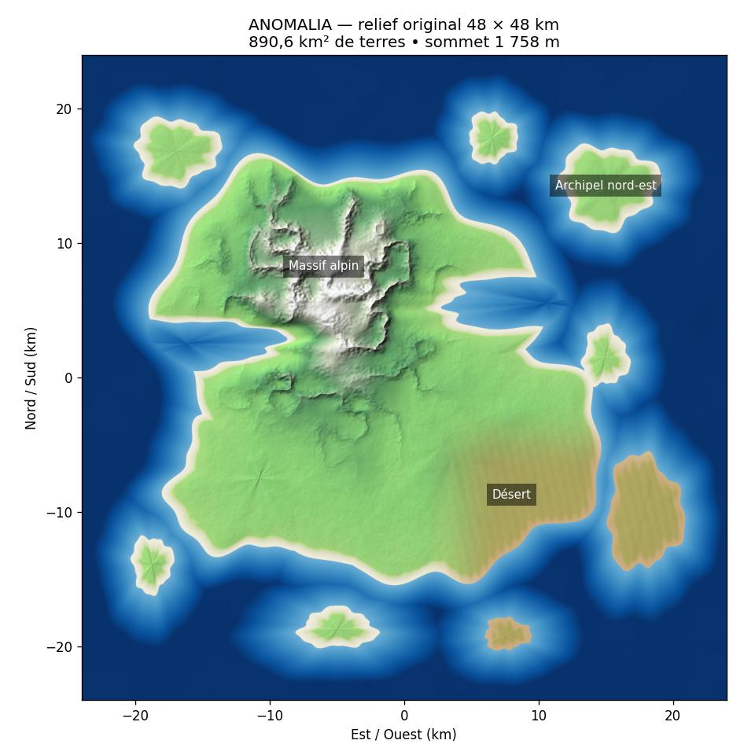

# ANOMALIA — niveau original natif, preuves

État courant et reprise : [audit principal](../../AUDIT_WORK_ANOMALIA_2026-10-20.md).
Les sections ci-dessous constituent un historique chronologique ; les premières
limitations peuvent avoir été levées dans les sections et rapports plus récents.

Création réelle validée sous Unreal Engine 5.8.3 sur le commit 1b74e33771b82eee3facde5def36e5f0459b1696.
Run : https://github.com/znationcmd/ANOMALIA-PRIMEVAL-OUTBOUNDUN/actions/runs/39479732171

- Editor et Game : compilations natives réussies.
- ProfileIsolation, TransportDynamics, VehicleCatalog : tests natifs réussis.
- Carte réellement créée : `/Game/Maps/ANOMALIA_Archipelago_v2`.
- 48 × 48 km, résolution 3025, 576 composants de terrain et 576 composants de collision.
- 145 LandscapeProxy : un Landscape principal et 144 proxies de streaming.
- Mesure analytique indépendante à 25 m : 890,634 km² de terre, sommet 1757,97 m.
- Huit masses terrestres de plus de 1 km² à la résolution d'import.
- Matériau de biomes, surface marine visuelle sans vagues, soleil, atmosphère et point de départ côtier.
- Rapport natif conservé dans `archipelago-created-39479732171.json`.
- Archive Unreal avec .umap, acteurs externes et matériaux : artefact `ue5-archipelago-world`, ID 12291217247, 19 342 101 octets compressés.
- SHA-256 de l'archive Actions : 0ca567ca58c76464a8e22cf84d4a19be3fd37ac5aec70cd72cbce5a33ee5fecd.
- L'archive Actions est conservée 90 jours. La génération reste reproductible à partir du code ; conserver une copie des créations modifiées par les utilisateurs.

Sur le PC du runner : `scripts/ue5/open-archipelago-world.cmd` ouvre le projet correct et cette carte directement. Les anciennes cartes et heightmaps sont conservées. Le brouillon v1 issu d'une tentative échouée n'est pas écrasé.

État prouvé : LEVEL_CREATED_NOT_PLAYTESTED. Le lancement réel du mode Jouer, la marche, les collisions en action et l'inventaire seront vérifiés par le test natif séparé Anomalia.World.ArchipelagoPIE. Le rendu GPU, le multijoueur et les performances ne sont pas validés.

Le test d'inventaire PIE utilise un acteur de test transitoire propre au test pour ne pas modifier un profil joueur chargé. La présence du composant d'inventaire sur le véritable personnage est également vérifiée.

## Historique — éléments absents avant le lot du pont

Ponts, routes, chemins, sentiers, villes, villages, bâtiments RP, ports, bases militaires, aéroport, végétation 3D, navmesh, IA, zombies, animaux, dinosaures et drones pilotables. La présence d'un catalogue ne vaut pas intégration. Ces éléments doivent être ajoutés par lots après validation du niveau en mode Jouer.

## Mode Jouer réellement validé — run 39480888218

https://github.com/znationcmd/ANOMALIA-PRIMEVAL-OUTBOUNDUN/actions/runs/39480888218
Commit 608d9eb1503f6bb54ac6dbd6dbaa6f5eb69ff469 ; UE5.8.3 ; Editor + Game compilés.
Anomalia.World.ArchipelagoPIE : Success, zéro erreur et zéro avertissement dans le résultat du test.
Carte chargée, vraie session Play In Editor lancée, personnage natif possédé,
contact avec le Landscape vérifié par trace physique, déplacement réel de 729,4 cm,
maintien au sol après marche, présence de l'inventaire natif et ajout/retrait d'un bandage
sur un acteur transitoire du test. Rapport `world-pie-39480888218.json`.
État acquis pour le niveau de base : TESTED_IN_EDITOR_HEADLESS.
Ni rendu GPU, ni performances, ni multijoueur ne sont validés.

## Lot suivant — viaduc du Détroit, en validation

Modèle 3D original : travée de 50 m, chaussée 8 m, largeur totale 11 m,
trottoirs, poutres, entretoises et garde-corps tubulaires. Réutilise les images
CC0 asphalt_02 et concrete_wall_001 déjà présentes dans le jeu JS.
Assemblage prévu : 50 travées sur 2,5 km entre (13500,-9000) et (16000,-9000),
avec piles cylindriques descendues jusqu'au fond. Append uniquement ; aucun acteur
existant supprimé ou remplacé. Chaque travée est un acteur séparé pour World Partition.
Le test PIE étendu doit vérifier le chargement distant, la collision et la marche sur
le tablier avant de déclarer ce pont traversable. Rendu et conduite non vérifiés.
Les autres infrastructures, bâtiments, IA, créatures et drones restent à intégrer.

## Pont posé et testé en PIE — run 39482943337

https://github.com/znationcmd/ANOMALIA-PRIMEVAL-OUTBOUNDUN/actions/runs/39482943337
Commit source : c3c287a2607ef6a926b0f9a225698913956ed773. Native Editor et Game compilés,
trois tests natifs initiaux réussis, import du pont et test PIE étendu réussis.
50 travées et 102 piles enregistrées dans la carte existante, sans remplacement des
acteurs antérieurs. GLB original de 457356 octets, 1836 triangles, 3 matériaux et
2 textures réutilisées. Garde-corps et trottoirs en géométrie 3D.

Résultat exact Anomalia.World.ArchipelagoPIE : Success, 0 avertissement, 0 erreur.
Marche réelle sur Landscape : 730,7 cm. Après téléportation dans la session PIE,
attente du chargement distant, trace physique sur un acteur du pont et marche sur
tablier : 641,8 cm, personnage au sol en fin de test. L'inventaire isolé passe aussi.
Ce test ne parcourt PAS tout le pont, ne teste pas encore les raccordements de rive,
la conduite, les IA, le rendu GPU, les performances ni le multijoueur.

Le rapport de placement reste volontairement PLACED_NOT_PLAYTESTED : il décrit
l'étape précédant le test. Le résultat PIE séparé ci-joint apporte la preuve de la
marche testée après ce placement. Ne pas réécrire les preuves originales.

Preuves conservées : bridge-placed-39482943337.json, world-pie-39482943337.json,
pie-test-results-39482943337.json. Archive carte/acteurs/matériaux/pont :
artefact ue5-archipelago-world ID 12292462366, 20793464 octets,
SHA-256 488ed88a3fe638aa925c77789c69f68c08c5800e44141c7af459659c5f582618.

## Reprise technique

Branche : ue5/integrate-world-homestead-20261020 ; PR 4, pas de fusion main.
Projet du runner Windows :
C:/Users/utilisateur/actions-runner/_work/ANOMALIA-PRIMEVAL-OUTBOUNDUN/ANOMALIA-PRIMEVAL-OUTBOUNDUN/unreal/AnomaliaPrimeval.uproject
Carte : /Game/Maps/ANOMALIA_Archipelago_v2 ; lanceur : scripts/ue5/open-archipelago-world.cmd.
Marqueur du pont : unreal/Saved/AnomaliaMigration/detroit-bridge-v1.json.
Les futures exécutions préservent la carte et le pont existants et rejouent les tests.
Le zip du monde doit conserver ses dossiers Content/Maps, __ExternalActors__,
__ExternalObjects__, Anomalia/World et Anomalia/Infrastructure ensemble.

Reste : raccordements et traversée complète du pont, routes/chemins/sentiers,
ports/aérodromes/bases, végétation réelle, villes et bâtiments RP accessibles,
IA/animaux/zombies/dinosaures et drones pilotables. Ces éléments ne sont pas déclarés
intégrés par le présent lot. Un modèle de berline CC0 détaillé est déjà embarqué dans
src/sedan-asset.js (72 meshes, 9 matériaux) ; le réutiliser pour le prochain lot de
véhicules, sans perdre les pièces ni le confondre avec les modèles précis demandés.

## Continuous bridge crossing — native evidence, run 39485038140

Source commit: `e647a39850ad0ce30e8993c988bc9710dbc1a94e`.

Editor and Game compiled successfully under the installed UE 5.8.3 host. The three
`Anomalia.Native` automation tests passed. `Anomalia.World.ArchipelagoPIE` passed
with a continuous **2450.3 metre** character crossing, visiting all **50 spans in
sequence**. The test teleports to its initial position only, then uses native
CharacterMovement and collision for the crossing. It pauses movement before
unloaded collision and resumes at that same position. Speed is accelerated to
25 m/s on the PIE test character only; this is neither a normal walking speed
claim nor a vehicle driving test. Original terrain movement and isolated inventory
add/remove also passed.

Evidence artifact: `12294225168`; SHA-256
`3d2bb4ccf423809a1485ac60f09391326aa6a25c161bfc249e728618a4f3fc3b`.
Copied original reports: `world-pie-39485038140.json`,
`pie-test-results-39485038140.json`.

No rendered quality, FPS, vehicle or multiplayer validation is inferred.

### Next lot currently submitted

Commit `6bb306dd6078f09e49b614992c47082b75d4ebbf` adds two original, terrain-following
500 m approaches (8 m asphalt roadway, 11 m including shoulders), reusing existing
CC0 Poly Haven asphalt/concrete images. Geometry is tessellated every 5 m and
blends into the unchanged bridge endpoints. The native workflow imports actual
meshes, configures complex collision, appends separate tagged actors and saves
the existing World Partition map. No existing actor, map or save is replaced.

Le run `39485506803` a compilé et importé les routes mais son PIE a échoué.
Le diagnostic `39488011249` confirme un contact avec le Landscape devant la
route au raccord ouest (X du personnage : 1345376 cm). Le mélange de hauteur
aplatissait et enfouissait la chaussée à la fin de la pente. Le correctif
`730d7d168b5aef5878bea7bacd2441d70258580b` mélange uniquement l'offset du raccord,
conserve les anciens maillages et le marqueur v1, et réutilise les acteurs existants.
Validation du correctif : run `39488623890`, résultat encore en attente.
Ne pas annoncer le parcours complet de 3490 m avant réussite native.
Les rapports des deux échecs restent conservés à côté des rapports de succès.

## Mise à jour du 21 octobre — routes validées, rendu en correction

Run 39490454207, source e990adf53df99dff53a5e2fb3e6112f586d4bc9c :
compilations Editor/Game et test PIE réussis, **3490,4 m** parcourus, 50 travées
visitées en ordre, avec les deux routes d'accès. Le marqueur v3 persiste la
référence du composant corrigé ; les anciens modèles et marqueurs restent conservés.
La tentative de rendu D3D11/SM5 a échoué (réentrance Slate/Python puis perte du
périphérique graphique). Aucune capture ou démo Windows n'est validée.
Consulter l'audit principal pour la reprise et les 54 nouvelles demandes de véhicules.
