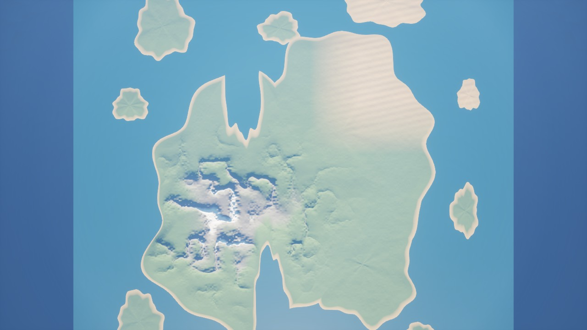
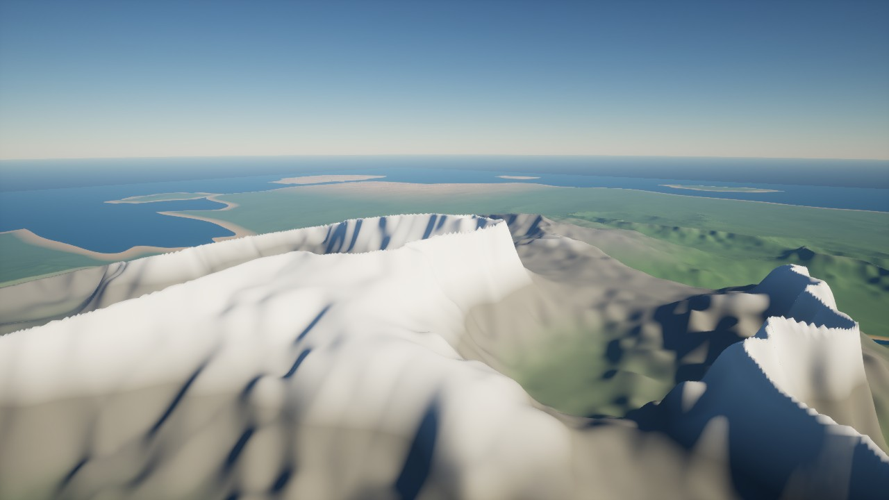
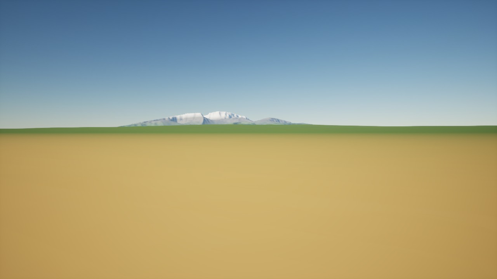
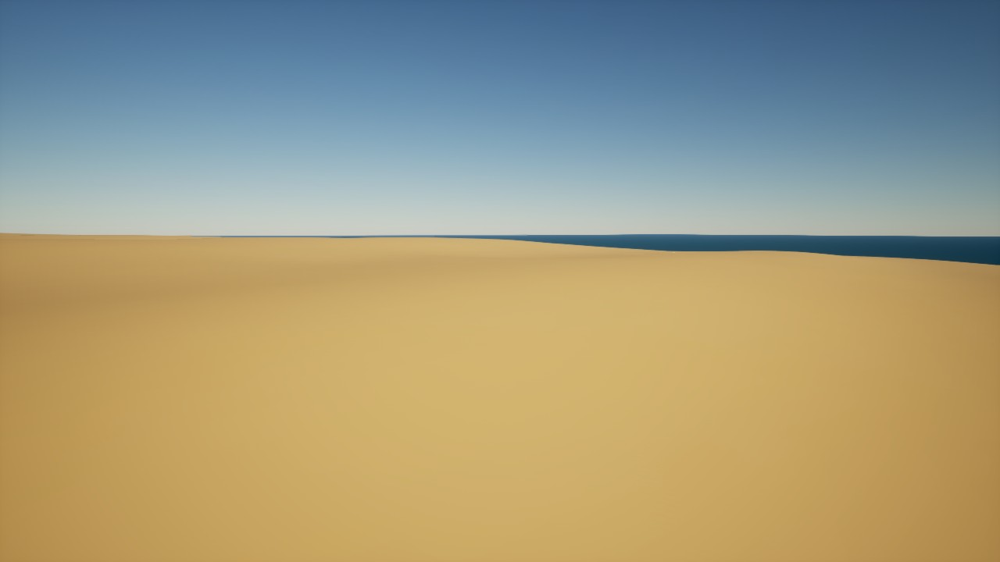
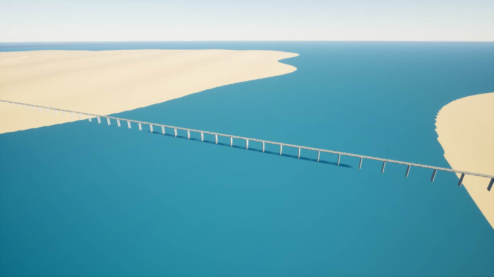

# Captures réelles Unreal — 21 octobre 2026

Source `cca28b25431eba5093e064957f56e4724f32c13f`,
[exécution native 39576659556](https://github.com/znationcmd/ANOMALIA-PRIMEVAL-OUTBOUNDUN/actions/runs/39576659556).
Véritable viewport Unreal 5.8.3, GPU DX11/SM5, 1280×720.
JPEG encodés à qualité 90 à partir des PNG natifs, sans retouche ni génération d'images.
Les SHA256 des PNG originaux et des JPEG sont dans `../../render-reviewed-39576659556.json`.
Originaux PNG et journaux : artifact 12334009161, expiration Actions selon rétention.

Le relief est visible après reconstruction GPU des couches existantes. Matériaux
provisoires, pas de végétation détaillée, mer en plan visuel. Ces vues ne prouvent
ni performances de jeu, ni version Windows installable, ni réouverture persistante.
La vue plage montre surtout le sable et doit être recadrée vers le rivage.

